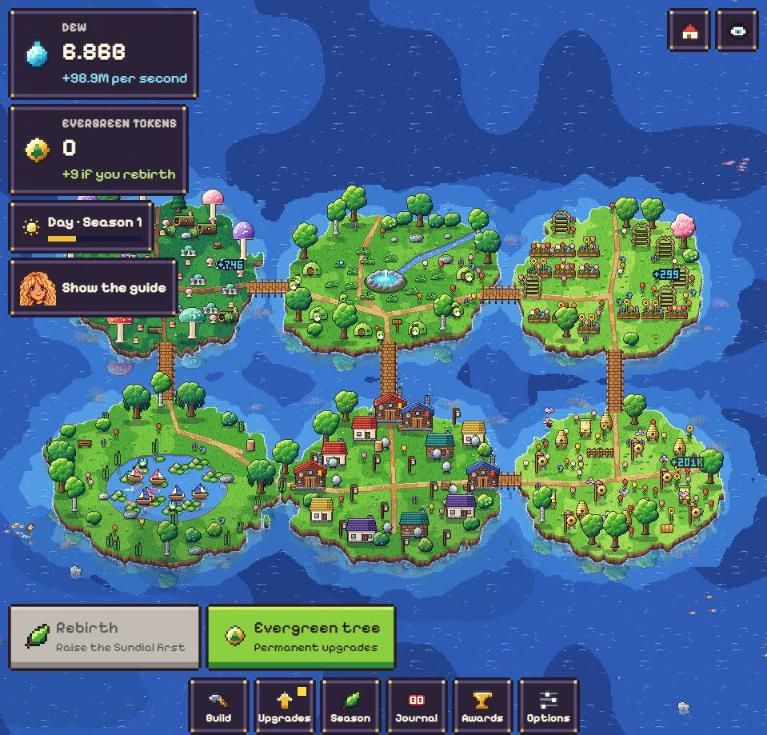
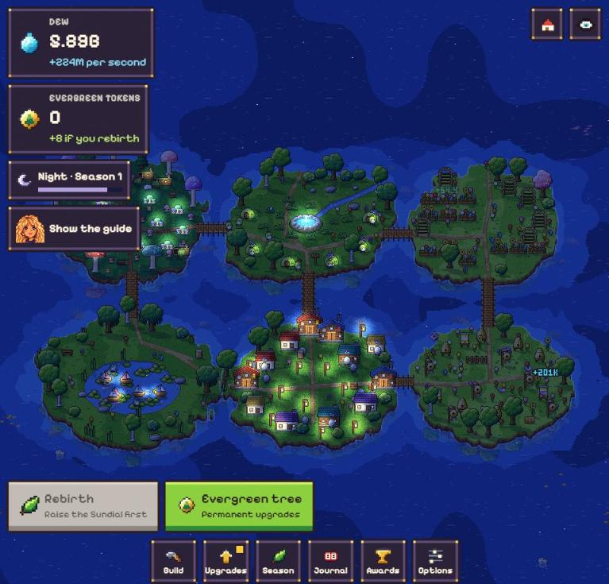
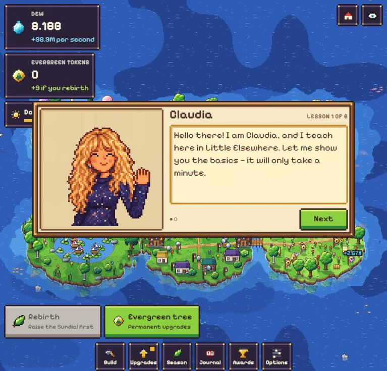

# Little Elsewhere

A small, cozy pixel-art game about growing a tiny world out of a single spring.



You start with one spring that hums when you touch it. Tap it for dew, plant a few ferns, and
before long creatures move in and the first new island rises out of the sea. There is a petal
garden, a mushroom grove, a pond with little boats, a meadow full of hives and a hamlet that
lights its lanterns at night.

When the world has grown as far as it can, you turn the season and start again, keeping a few
Evergreen Tokens that make every later season go further. A full playthrough to the ending takes
about two hours. After that you are welcome to stay.

## A look around

<p>
  
  
</p>

At night the lanterns come on and some things only gather dew in the dark. Claudia teaches the
basics in six short lessons, and she is there again when you come back after time away.


## How it plays

- Tap the spring for dew. Dew buys everything.
- Plant and build. Whatever you buy appears out in the world and keeps gathering by itself.
- Use the pointer for more than tapping: sweep up the dewdrops that form on everything, shake
  trees and bushes, pet the creatures, and drag a rain cloud over whatever should grow faster.
- Save up to discover new land. Each island brings new things to build.
- When progress slows, press Rebirth. The world starts over from the spring, but your Evergreen
  Tokens and what you grew with them stay for good.
- Close the tab whenever you like. The world keeps busy while you are away.
- It plays on a phone or a tablet too, upright or on its side: tap, drag to look around, pinch
  to zoom, and rest a finger on anything to read about it.

## Running it

You need [Node.js](https://nodejs.org). It is developed with Node 26.

```
npm install
npm run dev
```

Then open http://localhost:5183 in your browser.

To make a version you can host anywhere as plain files:

```
npm run build
```

The result is in `dist/`. Your progress is saved in the browser, on your own machine.

## How it is made

None of the game's art or sound is stored as a file. Every sprite, every sound and every frame of
the interface is drawn or synthesised in code when the game starts. It is written in TypeScript,
with React for the menus and Vite to build it.

Nearly everything about the game, from prices to the shape of the islands to what Claudia says,
is plain data in `src/config/`. If you would like to change something, the notes in
[docs/DEVELOPING.md](docs/DEVELOPING.md) say where to look.

## Made by

[Ryhox](https://github.com/Ryhox). The source lives at
[github.com/Ryhox/little-elsewhere](https://github.com/Ryhox/little-elsewhere).

The game keeps your progress in your own browser and collects nothing; the details are in its
[privacy note](public/privacy.html).

## License

[MIT](LICENSE)
